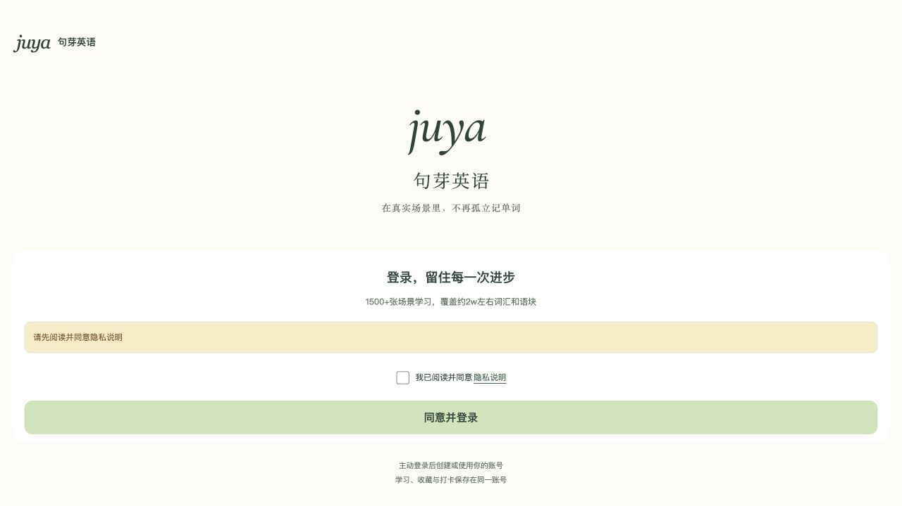

# 测试环境 OSS 字体迁移验证

验证日期：2026-10-25。

## 范围与加载策略

四份 WOFF 从原有内嵌字体无损提取，存档于 `resources/oss/fonts/`，不参与静态目录复制。仅上传至 `juya-test/miniapp/static/fonts/`。测试、开发和本地分享环境通过 `VITE_REMOTE_FONTS=true` 启用；生产为 `false`，保留原有四份内嵌字体，未修改生产桶。

`App.onLaunch` 并行启动四个全局 `uni.loadFontFace` 请求，不等待请求完成。页面初始使用系统字体；每份字体成功后独立切换对应字体，正体和斜体分别判定。请求失败、接口不存在、同步抛错、缺失 HTTPS 地址均保持页面可用；重复初始化不会重复请求。

| 字体          | 文件                                 |    字节 |
| ------------- | ------------------------------------ | ------: |
| DM Sans       | `dm-sans-19b2ba846548.woff`          |  47,924 |
| Fraunces 正体 | `fraunces-regular-1a07e715bff9.woff` |  88,448 |
| Fraunces 斜体 | `fraunces-italic-0e42d420e3d2.woff`  |  12,640 |
| 中文子集      | `juya-ui-chinese-2de0b76bda1d.woff`  | 157,260 |

文件名包含 SHA256 前 12 位。四份匿名 HTTPS GET 均为 200，下载内容与仓库源文件 SHA256 完全相同。响应类型为 `font/woff`，缓存为 `public,max-age=31536000,immutable`；更换字体时使用新哈希文件名。

## OSS 配置

桶 ACL 仍为私有，复用已获用户批准的 `miniapp/static/*` HTTPS GetObject 策略。原有两条 CORS 规则保留；新增规则仅允许 GET/HEAD，覆盖微信 `https://servicewechat.com`、现有测试 H5 域名及本机开发来源。模拟器使用随机本机端口，因此加入 `http://127.0.0.1:*` 与 `http://localhost:*`。已核验模拟器端口和微信来源获得对应 `Access-Control-Allow-Origin`，无关来源不获得该响应头。

## 自动检查与包体

- `pnpm check` 通过：格式、ESLint、Stylelint、TypeScript。
- `pnpm test` 通过：70 个测试文件、334 项测试。
- 构建契约实际编译测试及生产模式：测试产物没有内嵌字体或独立 WOFF；生产四份字体解码后的 SHA256 与原件一致。
- 单元测试覆盖真实 App 启动调用、去重、错误分支、AppPage 字体切换，以及正体/斜体不同加载顺序。

| 构建模式                     | 主包字节 |   MiB |
| ---------------------------- | -------: | ----: |
| 测试发布构建                 |  362,130 | 0.345 |
| 生产发布构建（保留内嵌字体） |  769,619 | 0.734 |
| 本地热更新构建               |  637,385 | 0.608 |

测试发布主包比保留字体的生产构建减少 407,489 字节，约 53%。本地热更新目录为 `dist/dev/mp-weixin`，`pnpm dev:mp-weixin` 持续监听源码变更。

## 页面验证

- 浏览器 390×844：四份字体加载回调成功，FontFaceSet 数量为 4，正文、英文正体及斜体变量分别切换至设计字体；应用无控制台错误。
- 使用不存在的资源前缀构建失败场景：字体数量为 0，系统字体/Georgia 兜底；点击未勾选隐私说明的登录按钮仍出现正常提示。该测试未修改仓库环境配置。
- 微信开发者工具 Stable 2.02.2608080 / 基础库 3.17.4：修正随机本机端口 CORS 后，冷启动可进入学习页，并打开登录页，水彩背景、品牌字标、正文及按钮正常显示。控制台探查命令不受当前上下文支持，产生的探查错误已清除；不据此声称四份原生字体回调均已验证。
- 用户已使用手机扫码检查，确认显示效果正常。首次弱网时字体切换体验未单独进行真机专项验证。

加载成功：

全部字体请求失败后兜底（背景请求也被故意置为失败）：

