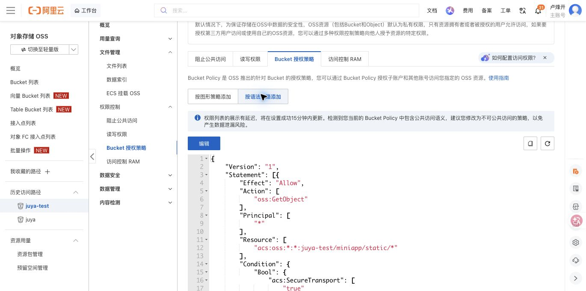
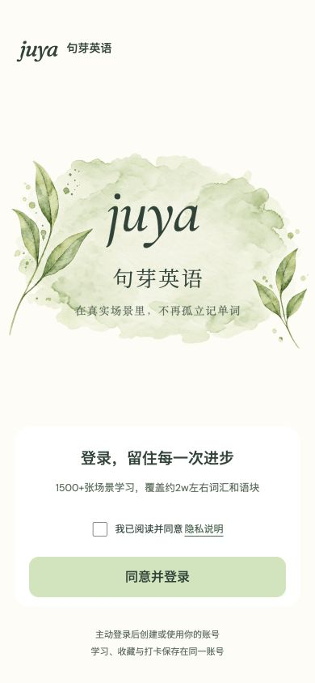

# 登录背景 OSS 迁移验证

日期：2026-10-25。仅迁移登录页植物装饰 PNG，不迁移字体、字标、分享图或原生 TabBar 图标，不发布小程序。

## 资源与构建

- 源图保存在 `resources/oss/brand/u00-botanical-watercolor@3x.png`，与迁移前的 Git 文件逐字节相同，大小 894,101 字节，SHA256 为 `bbab68ffff925bab6e8b3cbe2ccb6e0c0a5d6a8eaa582dc00c65007d933c06d0`
- 测试地址：`https://juya-test.oss-cn-shenzhen.aliyuncs.com/miniapp/static/brand/u00-botanical-watercolor@3x.png`
- 生产地址：`https://juya.oss-cn-shenzhen.aliyuncs.com/miniapp/static/brand/u00-botanical-watercolor@3x.png`
- `.env.development`、`.env.test`、两个本地分享预览环境和 `.env.example` 使用测试桶；`.env.production` 使用生产桶。可通过 `VITE_STATIC_ASSET_BASE_URL` 覆盖相应的 HTTPS 静态根地址，末尾斜杠会被移除。未配置根地址时不请求装饰图
- 生产源文件没有静态导入或本地原图回退，构建预算脚本额外拒绝重新混入原路径的植物 PNG。原生 TabBar 的四张 PNG 仍按本地路径打包

| 主包指标   | 修改前现有产物 | 测试构建 | 生产构建 |
| ---------- | -------------: | -------: | -------: |
| 未压缩字节 |      1,661,201 |  766,841 |  766,831 |
| MiB        |          1.584 |    0.731 |    0.731 |

项目默认 `dist/build/mp-weixin` 也已重新生成测试包，主包为 767,429 字节；比临时构建多 588 字节，来自原有的 `project.private.config.json`。两种输出均未包含植物 PNG

新构建均继续经过 20% 微信转换膨胀估计及至少 100 KiB 余量的原有门禁。这里的未压缩体积与微信官方上传后体积不同，不能作为上传成功回执。

## 自动验证

- 基线：67 个测试文件、311 项测试通过
- 新增回归先失败后通过：登录图使用 OSS 地址；装饰图错误后隐藏且登录仍可操作；真实小程序产物不包含原图且原生 Tab 图标齐全
- 完整套件：67 个测试文件、314 项测试通过
- `pnpm check`、测试和生产小程序构建均通过，覆盖格式、静态检查、类型、12 个页面配置、两个底部 Tab 与主包预算；工具链为 Node 22.22.0、pnpm 11.25.0

## OSS 实际验证

最初测试桶的匿名 GET 返回 403。现有 RAM 凭证不能读取 Bucket Policy，因此没有通过 API 覆盖无法读取的原有策略。在已登录的控制台中确认策略列表为空，但桶级“阻止公共访问”开启，首次添加目录规则被拒绝。

用户在临执行前明确确认“同意，仅调整 juya-test”后，已关闭该测试桶的阻止开关，并通过控制台保存以下唯一规则：

```json
{
  "Version": "1",
  "Statement": [
    {
      "Effect": "Allow",
      "Principal": ["*"],
      "Action": ["oss:GetObject"],
      "Resource": ["acs:oss:*:*:juya-test/miniapp/static/*"],
      "Condition": { "Bool": { "acs:SecureTransport": ["true"] } }
    }
  ]
}
```

- 测试桶 ACL 再次实测为 `private`；没有修改账号级开关、生产桶或任何对象内容
- 背景图和收藏选中图标的匿名 HTTPS GET 为 200，返回类型为 `image/png`
- 匿名目录列举为 403；背景图的 HTTP 访问为 403；从真实对象清单中抽查三份静态目录以外的既有业务对象，匿名 HEAD 均为 403
- 用户已上传的背景为 417,598 字节、1170×780 的调色板 PNG，SHA256 为 `9700e8b314e1926625de6caf5333f0b0a827e89a1b9f29a45a69cf48fdc19d45`。与归档的 894,101 字节原图不同，不能声称远程文件与原图哈希或像素完全一致。按用户要求复用现有文件，没有重新上传；两图在登录页背景色上合成比较，各 RGB 通道的平均绝对差异均低于 0.52/255
- 抽查远程 `juya-wordmark@3x.png` 返回 404，因此不能据此认定所有静态文件均已可用；该字标继续从本地加载，本轮功能不依赖其 OSS 副本



初始阻止状态记录在 [变更前截图](./oss-static-access-blocked.png)。

## 页面与发布边界

H5 测试构建通过。在 390×844 浏览器视口中验证真实登录页面：远程背景图 `complete: true`，自然尺寸 1170×780；本地字标、中文品牌名、标语和导航图标全部加载成功；浏览器无错误或警告。未勾选隐私同意直接点击登录后，仍显示“请先阅读并同意隐私说明”。装饰图失败后仍可登录的行为由组件回归测试覆盖。



生产桶保持现状；正式发布前仍须核验生产图片及权限，不能用测试桶验收替代生产验收。尚未进行 iOS、Android 微信真机的正常加载、弱网与请求失败验收，也没有上传或发布小程序。
